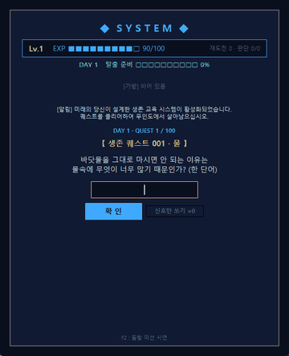

# 안녕하세요, leesm3528-netizen입니다 👋

K-Digital 피지컬 AI 과정에서 Python과 Git을 배우고 있습니다.
아이디어를 직접 실행되는 프로그램으로 만들고, 만든 과정을 기록하는 것을 좋아합니다.

## 🔭 관심 분야
- **피지컬 AI** — 실제 세계와 상호작용하는 AI
- **게임처럼 배우는 교육 프로그램** — 퀘스트·레벨업·보상으로 학습을 재미있게
- **웹으로 공유하기** — 만든 프로그램을 누구나 브라우저에서 실행할 수 있게

## 📚 지금까지 배운 것
| 분야 | 내용 |
|---|---|
| Python 기초 | 리스트·딕셔너리, 함수, 조건문·반복문, JSON 파일 읽기 |
| GUI | tkinter로 창·버튼·입력칸 만들기, Canvas 애니메이션 |
| 웹 | Flask 서버, HTML·CSS·JavaScript, API로 데이터 주고받기 |
| 협업 도구 | Git 커밋·푸시, GitHub 저장소, GitHub Pages 배포, Markdown |

## 🏝 작품
### [무인도 생존 교육 시스템](https://github.com/leesm3528-netizen/island-survival-system)
> 미래의 내가 설계한 '시스템 창'이 생존 퀘스트를 내고, 레벨업하면 구조 헬기가 보급품을 떨어뜨린다.
> 해안가에 떠밀려 온 표류자를 단서로 판단해 구할지 경계할지 정하고, 그 선택이 탈출 엔딩을 바꾼다.

- 퀘스트 100개 · 표류자 5명 · 엔딩 3개
- Python tkinter 버전 + Flask 웹 버전
- ▶ [브라우저에서 바로 플레이](https://leesm3528-netizen.github.io/island-survival-system/)
- 📘 [만든 과정 학습 정리](https://github.com/leesm3528-netizen/island-survival-system/blob/main/STUDY_NOTES.md)
